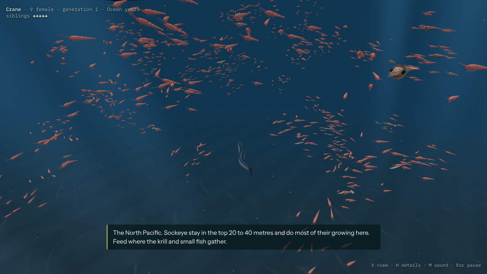
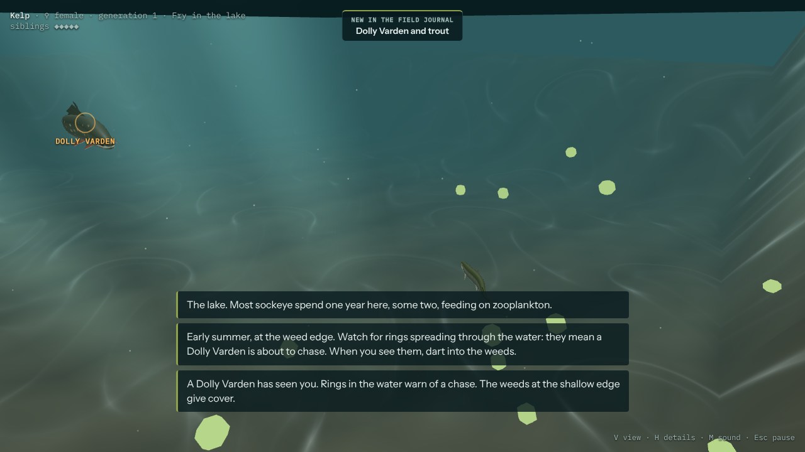
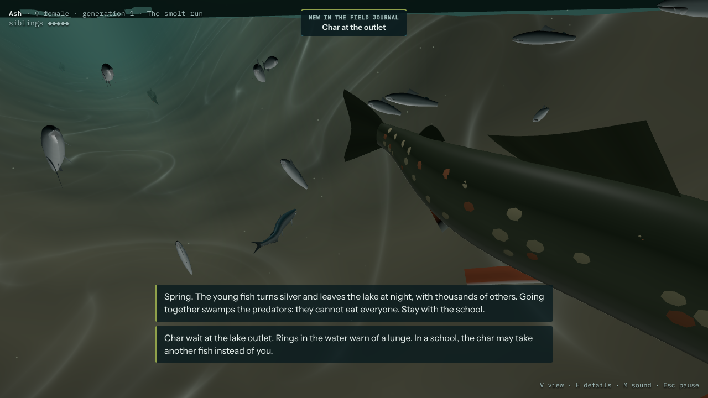
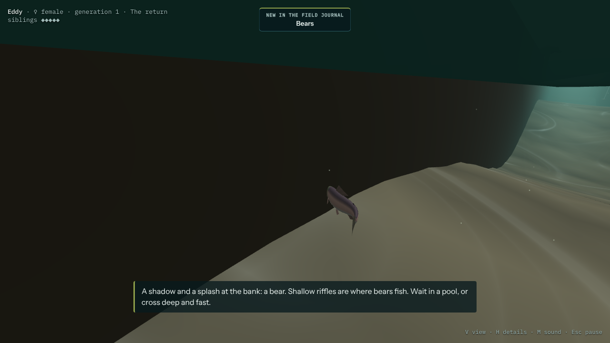
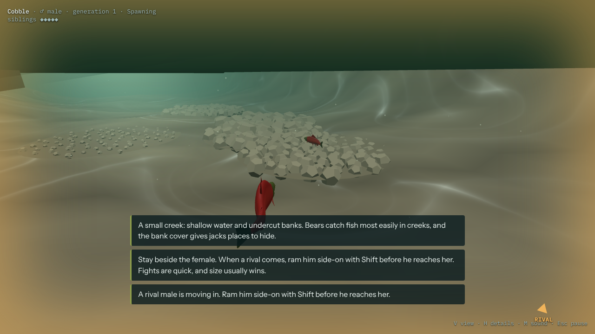

# Homewater

**Live one sockeye salmon's whole life, then carry on as one of its offspring.**

Homewater is an original lifecycle simulator that runs in your browser. You start as an egg in the gravel of a cold stream, and if you are quick, careful and a little lucky, you end up years later back in that same stream, spawning. It is a free passion project.

**Play it here: [ajacobscoldcall-boop.github.io/homewater](https://ajacobscoldcall-boop.github.io/homewater/)**

Best on a desktop or laptop with a keyboard, in Chrome, Edge or Firefox. A whole life takes about 8 to 10 minutes.



A short clip: [docs/media/homewater-clip.webm](docs/media/homewater-clip.webm)

## The six stages

1. **Egg and alevin:** hatch in the gravel, face into the current, then swim up toward the light.
2. **Fry in the lake:** a year in short scenes: hide in the weeds, feed at dusk, wait out the winter under the ice.
3. **The smolt run:** leave the lake at night with your school, past char, diving birds and a seal.
4. **Ocean years:** feed where the krill gather, and dodge orca, seals and salmon sharks.
5. **The return:** follow the magnetic track to the coast, thread the nets, smell out your home river, and get past bears and anglers.
6. **Spawning:** dig a redd, fight for a mate, or sneak in as a small "jack" male.

## Lineage and genetics

Your fish carries heritable traits (size, run timing, years at sea, homing, body shape and more). Its offspring inherit them with some variation, so over the generations your bloodline changes, shaped by which fish survive and spawn.

## Controls

| Key | Action |
|---|---|
| Click the game | Capture the mouse for steering (Esc releases it and pauses) |
| Mouse or A / D | Steer |
| W | Swim forward |
| S | Ease off and hold position against the current |
| Space / C | Rise / dive (in the egg stage, Space wriggles) |
| Shift | Burst: fast, but burns energy |
| E | Act: dig the redd, or dart in as a jack |
| V | Third- or first-person view |
| H | Show details: energy, fat, oxygen, growth, depth |
| M | Sound on or off |
| Esc | Pause (J opens the field journal) |

The title screen also has **How to play** and **About** panels.

## Screenshots

| | |
|---|---|
|  |  |
|  |  |

More views of every fish and animal model are in [docs/gallery](docs/gallery/).

## The science

The biology follows published research on sockeye salmon; see the Sources section of [docs/DESIGN.md](docs/DESIGN.md). Some numbers are simplified or tuned so the game plays well.

**Content warning:** the game shows predation, deaths from fishing, and decay. A Gore setting on the title screen cuts away before the worst of it.

## Run it locally

You need [Node.js](https://nodejs.org/) 20.19 or later.

```
npm install
npm run dev        # local dev server; open the address it prints
npm run verify     # typecheck, unit tests, production build, browser smoke tests
```

Add `?debug=1` to the address for playtest tools, or `?gallery=1` for the model gallery.

## Built with

[three.js](https://threejs.org/) (WebGL), TypeScript and Vite. Every fish and animal is built in code, and the sound is generated live in the browser. Fonts: Bricolage Grotesque, Instrument Sans and IBM Plex Mono (Google Fonts).
